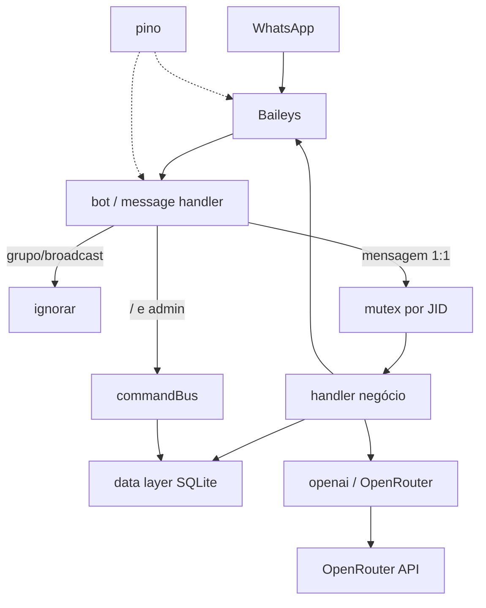

# Architecture

| Campo | Valor |
|-------|-------|
| Sistema | OrbitBot (Baileys — implementado) |
| Última actualização | 2026-07-26 |
| Branch | `refactor/wppconnect-to-baileys` |
| Estado | implementado (Fase 2–5 OK; E2E WhatsApp manual pendente do operador) |

## Visão geral

Bot WhatsApp 1:1: Baileys recebe mensagens privadas → filtro → admin command bus **ou** handler IA (com mutex por JID) → envio imediato. Persistência SQLite unificada; IA via OpenRouter.



## Camadas

| Camada | Responsabilidade | Tecnologia |
|--------|------------------|------------|
| Canal | Sessão, QR, eventos, envio | `@whiskeysockets/baileys` |
| Aplicação | Filtro 1:1, admin, mutex, orquestração resposta | Node.js (`app.js`, `src/bot.js`, commands) |
| IA | Prompt, personalidade, modelo, chamada HTTP | `openai.js`, `aiConfig.js`, `openrouterProvider.js` |
| Domínio/Dados | clientes, historico, config, backup | SQLite + interface única |
| Observabilidade | Logs estruturados | `pino` |

**Removido do alvo:** MessageQueue, pipeline, PluginSystem, dashboard Express/HTTP:3000.

## Fluxos principais

### Fluxo 1 — Mensagem 1:1

1. Baileys emite mensagem; handler descarta se grupo/broadcast/`fromMe` (conforme política).
2. Normaliza JID/número.
3. Se corpo começa com `/` e JID ∈ `ADMIN_NUMBERS` → `commandBus` → `sock.sendMessage` imediato.
4. Senão: adquire mutex do JID (fila interna por user se já em processamento).
5. Carrega/cria cliente + histórico recente via data layer.
6. Chama IA (OpenRouter); grava `user` + `assistant` no histórico.
7. Baileys envia o texto de uma vez (`sock.sendMessage`).
8. Liberta mutex.

### Fluxo 2 — Bootstrap

1. `dotenv` no entrypoint.
2. Inicializa SQLite (schema + tabela `config`).
3. Carrega config (personalidade/modelo) para `aiConfigManager`.
4. Inicia Baileys com auth state em pasta local (ex. `auth/` ou `baileys_auth/`).
5. Imprime QR no terminal; reconecta em queda.

### Fluxo 3 — Persistência de `/ai`

1. Admin altera personalidade/modelo.
2. Data layer faz upsert em `config`.
3. Estado em memória actualizado.
4. Reinício do processo reidrata a partir de `config`.

## Integrações externas

| Sistema | Protocolo | Propósito |
|---------|-----------|-----------|
| WhatsApp (via Baileys) | WebSocket / protocolo WA | Canal de mensagens |
| OpenRouter | HTTPS REST | Chat completions |

## Estrutura de pastas alvo (simplificada)

```
OrbitBot/
├── app.js
├── package.json
├── .env.example
├── auth/                    # sessão Baileys (gitignored)
├── database/
│   ├── data/orbitbot.db
│   ├── backups/
│   └── …                    # interface unificada
└── src/
    ├── bot.js
    ├── openai.js
    ├── aiConfig.js
    ├── backup.js
    ├── logger.js            # pino
    ├── concurrency.js       # mutex por JID (nome final a definir na implementação)
    ├── providers/openrouterProvider.js
    └── commands/
        ├── commandBus.js
        └── admin/{ai,backup,db,history}.js
```

## Decisões arquitecturais

| Decisão | ADR |
|---------|-----|
| Baileys + remoção Queue/Plugins/Dashboard | ADR-0001 |

## Considerações operacionais

- Deploy: processo Node único (`npm start`); sem porta HTTP obrigatória.
- Observabilidade: pino stdout/stderr.
- Escalabilidade: processo single-instance; mutex só em memória (não multi-process).

## Segurança (visão arquitectural)

- Autenticação canal: sessão WhatsApp (QR).
- Autorização admin: whitelist `ADMIN_NUMBERS` (env).
- Dados sensíveis: `.env` e pasta `auth/` fora do git; DB local.
- Sem dashboard público.
