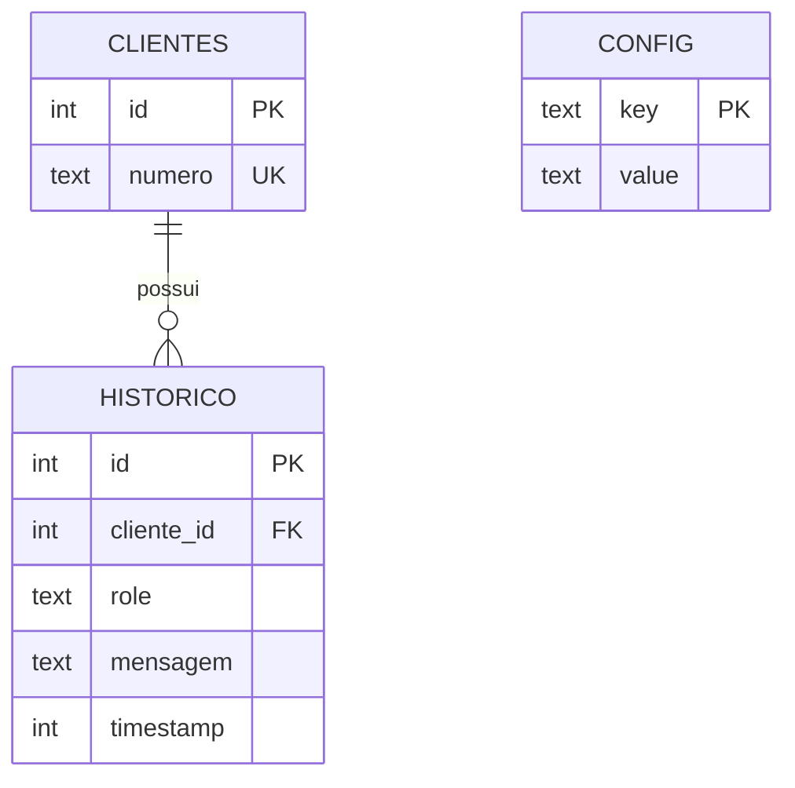

# Data Model

| Campo | Valor |
|-------|-------|
| SGBD | SQLite 3 |
| Ficheiro | `database/data/orbitbot.db` |
| Última actualização | 2026-07-26 |

## Diagrama ER (descrição)

```
clientes 1──N historico
config (chave/valor independente)
```



## Entidades

### clientes

| Campo | Tipo | Null | Default | Descrição |
|-------|------|------|---------|-----------|
| id | INTEGER | NO | AUTOINCREMENT | PK |
| numero | TEXT | NO | — | Identificador único (JID ou número normalizado) |

**Índices:**

- `UNIQUE(numero)`

**Regras:**

- Criado sob demanda no primeiro contacto.

---

### historico

| Campo | Tipo | Null | Default | Descrição |
|-------|------|------|---------|-----------|
| id | INTEGER | NO | AUTOINCREMENT | PK |
| cliente_id | INTEGER | NO | — | FK → clientes.id |
| role | TEXT | NO | — | `user` \| `assistant` |
| mensagem | TEXT | NO | — | Conteúdo |
| timestamp | INTEGER | NO | — | Epoch ms ou s (manter convenção actual do código) |

**Índices:**

- `idx_historico_cliente` em `cliente_id`
- `idx_historico_timestamp` em `timestamp`

**Regras:**

- Cada turno de conversa grava um par lógico: pergunta (`user`) + resposta (`assistant`).
- `/reset confirmar` apaga todas as linhas de `historico` e `clientes` (não apaga backups nem necessariamente `config` — ver migração).

---

### config (nova)

| Campo | Tipo | Null | Default | Descrição |
|-------|------|------|---------|-----------|
| key | TEXT | NO | — | PK (ex. `personality`, `model`) |
| value | TEXT | NO | — | Valor serializado (string) |

**Índices:**

- PK em `key`

**Regras:**

- Upsert em alterações via `/ai`.
- Boot reidrata `aiConfigManager` a partir destas chaves.
- Chaves mínimas: `personality`, `model` (aliases internos existentes).

## Relações

| De | Para | Cardinalidade | FK |
|----|------|---------------|-----|
| historico | clientes | N:1 | historico.cliente_id → clientes.id |
| config | — | — | Sem FK |

## Migrações previstas

| Ordem | Descrição | Breaking? |
|-------|-----------|-----------|
| 001 | `CREATE TABLE IF NOT EXISTS config (key TEXT PRIMARY KEY, value TEXT NOT NULL)` | Não |
| 002 | Seed opcional de defaults se vazio | Não |
| 003 | Unificar API de acesso (código); schema legado clientes/historico mantido | Não |

**Nota:** sem motor de migrations versionado — schema aplicado no boot com `IF NOT EXISTS`, alinhado ao padrão actual.

## Interface de dados (alvo)

Uma fachada única (ex. `database/` ou `src/data.js`) expondo, no mínimo:

| Operação | Descrição |
|----------|-----------|
| `getOrCreateClient(numero)` | Cliente |
| `appendHistory(clienteId, role, mensagem)` | Insert histórico |
| `getRecentHistory(identifier, limit)` | Últimas N |
| `getPagedHistory(identifier, page)` | Paginação admin |
| `getConfig(key)` / `setConfig(key, value)` | Config persistente |
| `resetAllData()` | Comportamento de `/reset confirmar` |

Repos `clientsRepo` / `historyRepo` deixam de ser a API pública (podem ser fundidos ou removidos).

## Considerações de performance

- Hot paths: `getRecentHistory` + append no fluxo de mensagem.
- Cache de respostas IA: se existir, chave **deve** incluir JID; preferível confiar no SQLite e omitir cache global partilhado.
- Backups: cópia do ficheiro `.db` para `database/backups/` (comportamento actual).

## Referências

- API: `docs/API_SPEC.md`
- ADR: `docs/adr/0001-migracao-wppconnect-para-baileys.md`
- Schema actual: `database/db/index.js`
