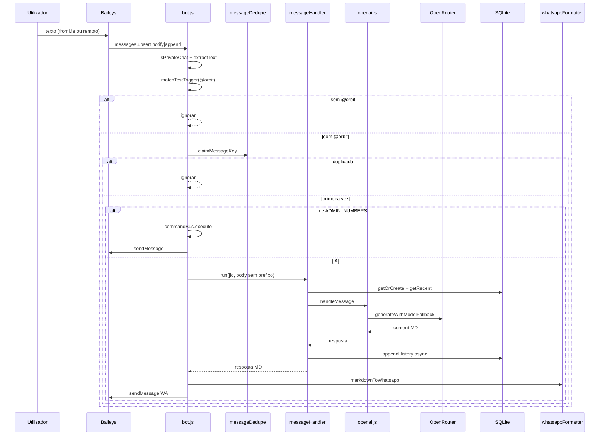
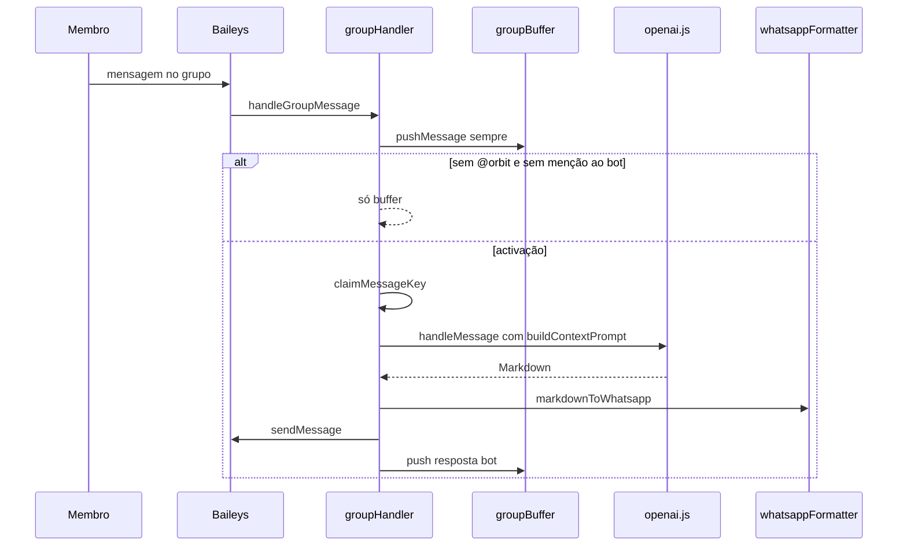
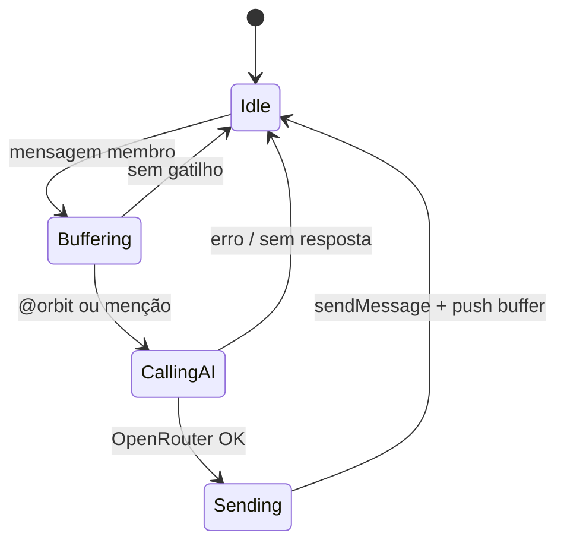

# OrbitBot — Relatório Geral Técnico

> Assistente WhatsApp (1:1 e grupos) com IA via OpenRouter, SQLite, Baileys e formatação nativa WhatsApp.

[]()
[]()
[]()
[]()

**Data do relatório:** 2026-07-28  
**Branch de referência:** `refactor/test-trigger-mode` (base Baileys)  
**Fonte de verdade:** código + `.agent_history.md` + `npm test` (48/48)  
**Escopo:** arquitetura actual, fluxos, dados, IA, grupos, formatação, admin, limitações

---

## Sumário

- [1. Visão geral](#1-visão-geral)
- [2. Arquitetura](#2-arquitetura)
- [3. Fluxos de mensagem](#3-fluxos-de-mensagem)
- [4. Dependências](#4-dependências)
- [5. Banco de dados](#5-banco-de-dados)
- [6. Backup](#6-backup)
- [7. IA — modelos, persona e provider](#7-ia--modelos-persona-e-provider)
- [8. Grupos](#8-grupos)
- [9. Formatação Markdown → WhatsApp](#9-formatação-markdown--whatsapp)
- [10. Comandos administrativos](#10-comandos-administrativos)
- [11. Concorrência, cache, retry e dedupe](#11-concorrência-cache-retry-e-dedupe)
- [12. Configuração e variáveis de ambiente](#12-configuração-e-variáveis-de-ambiente)
- [13. Estrutura de pastas](#13-estrutura-de-pastas)
- [14. Testes e verificação](#14-testes-e-verificação)
- [15. Limitações e TBD](#15-limitações-e-tbd)
- [16. Como executar](#16-como-executar)
- [17. Evolução (changelog sintético)](#17-evolução-changelog-sintético)
- [18. Referências](#18-referências)

---

## 1. Visão geral

O **OrbitBot** é um assistente pessoal via WhatsApp. O canal adopta **@whiskeysockets/baileys**; a IA passa por **OpenRouter** (cadeia de modelos com fallback); o contexto 1:1 persiste em **SQLite**; grupos usam **buffer em memória**.

| Dimensão | Decisão adoptada |
|----------|------------------|
| Canal | Baileys 6.7.18 — sessão em `./auth/` (QR no terminal) |
| Persistência 1:1 | SQLite (`database/data/orbitbot.db`) — `clientes`, `historico`, `config` |
| Grupos | Buffer RAM (máx. 40 msgs) — **sem** SQLite |
| IA | OpenRouter Chat Completions — `OPENROUTER_MODELS` ordenada |
| Persona | Ficheiro único `prompts/SYSTEM.md` |
| Admin | Comandos `/` no WhatsApp — whitelist `ADMIN_NUMBERS` |
| Observabilidade | `pino` (sem dashboard HTTP) |
| Formatação de saída | `markdownToWhatsapp` no envio Baileys |

**Responsabilidade do sistema:** responder em 1:1 (modo teste: prefixo `@orbit`) e em grupos (`@orbit` ou menção ao bot), com histórico contextual, fallback de modelos e texto compatível com a sintaxe nativa do WhatsApp.

**Removido face ao legado (pré-2026-07-26):** WPPConnect, MessageQueue, pipeline, PluginSystem, dashboard `:3000`, humanizer fragmentado, repositórios públicos, pasta `plugins/`.

---

## 2. Arquitetura

### 2.1 Topologia

```mermaid
flowchart TD
  subgraph entry [Entrada]
    WA[WhatsApp]
    BL[Baileys sock]
    APP[app.js]
  end

  subgraph core [Núcleo]
    BOT[bot.js]
    DEDUPE[messageDedupe]
    CB[commandBus]
    MH[messageHandler]
    LOCK[UserLock / concurrency]
  end

  subgraph groups [Grupos]
    GH[groupHandler]
    GB[groupBuffer RAM]
  end

  subgraph aiLayer [Camada IA]
    OAI[openai.js]
    CFG[aiConfig.js]
    OR[openrouterProvider]
    FMT[whatsappFormatter]
  end

  subgraph dataLayer [Dados 1:1]
    DATA[database / data layer]
    DB[(SQLite)]
    BK[backup.js]
  end

  APP --> BOT
  WA --> BL --> BOT
  BOT -->|@g.us| GH
  GH --> GB
  GH --> LOCK
  GH --> OAI
  BOT -->|1:1 @orbit| DEDUPE
  BOT -->|/ admin| CB
  BOT -->|IA 1:1| MH
  MH --> LOCK
  MH --> DATA --> DB
  MH --> OAI
  OAI --> CFG
  OAI --> OR
  BOT -->|send| FMT
  GH -->|send| FMT
  FMT --> BL
  BK --> DB
```

A topologia **isola** o canal Baileys da orquestração (`bot` / `groupHandler`), da IA (provider + fallback) e da persistência 1:1. Grupos partilham a mesma IA, mas **não** o SQLite de conversas — o contexto vive só em `groupBuffer`.

### 2.2 Bootstrap

```
npm start → node app.js
  ├─ filtra ruído libsignal (Closing session / Bad MAC) no stdout/stderr
  └─ startBot()
       ├─ aiConfigManager.hydrate()  ← prompts/SYSTEM.md (+ config SQLite se houver)
       ├─ avisos se faltar OPENROUTER_API_KEY / ADMIN_NUMBERS
       └─ connectWhatsApp()
            ├─ useMultiFileAuthState(auth/)
            ├─ makeCacheableSignalKeyStore
            ├─ QR via qrcode-terminal
            └─ messages.upsert → grupos | 1:1
```

Efeito colateral no `require`: `backup.js` agenda backup automático do SQLite (intervalo definido no módulo).

### 2.3 Padrões reconhecíveis

| Padrão | Onde |
|--------|------|
| Command Bus | `commandBus` + `commands/admin/*` |
| Provider | `openrouterProvider` isolado de `openai.js` |
| Mutex por chave | `concurrency.UserLock` — JID 1:1 e `group:{jid}` |
| Deduplicação | `messageDedupe.claimMessageKey` (TTL ~3 min) |
| Data layer unificada | `database/` — contrato em `docs/contracts/data-layer.md` |
| Sanitizador de saída | `utils/whatsappFormatter` (spec → implementação) |

---

## 3. Fluxos de mensagem

### 3.1 Um-para-um (modo teste `@orbit`)



**Regras 1:1 (branch actual):**

1. Aceita `type` `notify` **e** `append` (necessário para `fromMe` no Baileys).
2. Só processa se o texto começar com `@orbit` (case-insensitive) — `src/testTrigger.js`.
3. Prefixo removido antes de admin/IA.
4. Histórico SQLite guarda o Markdown **cru** da LLM; a conversão WA ocorre **uma vez** no envio (função não idempotente).

### 3.2 Grupo (`@g.us`)



**Regras de grupo:**

| Regra | Comportamento |
|-------|----------------|
| Buffer | Todas as msgs de membros (máx. 40; texto truncado a 300 chars) |
| Activação IA | `@orbit` **ou** menção JID do bot |
| `fromMe` | Ignorado **excepto** `fromMe` + `@orbit` (modo teste no telemóvel do bot) |
| Persistência | Sem SQLite — só RAM |
| Mutex | `group:{groupJid}` |
| Contexto | `buildContextPrompt` injecta o buffer **completo** (não corta por `maxHistory` 1:1) |

---

## 4. Dependências

Fonte: `package.json` (versão do produto `2.0.0`).

| Pacote | Versão | Papel |
|--------|--------|-------|
| `@whiskeysockets/baileys` | `6.7.18` | Sessão WhatsApp, eventos, envio |
| `@hapi/boom` | `^10.0.1` | Status de desconexão Baileys |
| `axios` | `^1.9.0` | HTTP OpenRouter |
| `dotenv` | `^16.5.0` | Carregar `.env` |
| `pino` | `^9.14.0` | Logs estruturados |
| `qrcode-terminal` | `^0.12.0` | QR no terminal |
| `sqlite3` | `^5.1.7` | Persistência 1:1 |

**Runtime:** Node.js ≥ 18 (desenvolvimento verificado com v24.18.0 via nvm).

---

## 5. Banco de dados

Ficheiro: `database/data/orbitbot.db` (gitignored).

| Tabela | Função |
|--------|--------|
| `clientes` | Identidade por número (dígitos) |
| `historico` | Mensagens `user` / `assistant` do fluxo 1:1 |
| `config` | Preferências chave/valor (reidratação `/ai` e hydrate) |

Contrato público da camada: `docs/contracts/data-layer.md`  
(`getOrCreateClient`, `appendHistory`, `getRecentHistory`, `getPagedHistory`, `getConfig`, `setConfig`, `resetAllData`).

**Grupos não escrevem nestas tabelas.**

---

## 6. Backup

`src/backup.js` gere cópias do SQLite (criar / listar / restaurar) e agenda backup periódico. Comandos admin: `/backup` (ver secção 10).

---

## 7. IA — modelos, persona e provider

### Persona

- Ficheiro: `prompts/SYSTEM.md` (caminho override: `SYSTEM_PROMPT_PATH`)
- Carregamento: `aiConfigManager.loadPrompt()` / `hydrate()`
- Admin: `/ai prompt`, `/ai prompt reload`
- **Removido:** catálogo de personalidades, aliases `AI_MODELS`, `/ai personalidade`, `/ai modelo`

### Cadeia de modelos

`resolveOpenRouterModels()` em `aiConfig.js`:

1. `OPENROUTER_MODELS` — JSON array ou CSV (ordem = prioridade)
2. Senão `OPENROUTER_MODEL` (lista de 1)
3. Senão default `deepseek/deepseek-chat-v3-0324:free`

`generateWithModelFallback` (`openai.js`):

- **1 tentativa por modelo**
- Em **timeout** → **não** retenta o mesmo modelo; passa ao próximo
- `401` / `403` → **não** avança na cadeia (falha de auth)
- Cache em memória (`src/core/cache.js`) indexado por user + mensagem + histórico + prompt + modelos

### Provider

`src/providers/openrouterProvider.js` — POST `https://openrouter.ai/api/v1/chat/completions` com AbortController/timeout configurável.

**Recomendação operativa:** colocar modelos estáveis primeiro; `openrouter/free` por último (fila/latência). Evidência 2026-07-28: free em 1º causava timeouts e percepção de “bot morto”.

---

## 8. Grupos

| Módulo | Responsabilidade |
|--------|------------------|
| `src/groups/groupHandler.js` | Routing, activação, IA, envio, fromMe+@orbit |
| `src/groups/groupBuffer.js` | Buffer FIFO 40 msgs / 300 chars |

Estado de máquina (simplificado):



---

## 9. Formatação Markdown → WhatsApp

| Artefacto | Papel |
|-----------|-------|
| `docs/WHATSAPP-MARKDOWN-MAPPING.md` | Spec / matriz De-Para + regras DEVE/NÃO DEVE + 16 contratos |
| `src/utils/whatsappFormatter.js` | `markdownToWhatsapp(input)` |
| `test/whatsapp-formatter.test.js` | Contratos sintéticos |

Equivalências críticas:

| Markdown | WhatsApp |
|----------|----------|
| `**negrito**` | `*negrito*` |
| `*itálico*` | `_itálico_` |
| `~~tachado~~` | `~tachado~` |
| `# Título` | `*Título*` |
| `` `code` `` / fences | preservados (lang tag removida) |

Integração: **só no `sendMessage`** (1:1 e grupos). Histórico SQLite permanece em Markdown da LLM.

---

## 10. Comandos administrativos

Autenticação: JID cujos dígitos ∈ `ADMIN_NUMBERS` (DDI, sem `@c.us`).

| Comando | Função |
|---------|--------|
| `/ai` | Help persona/cache/stats |
| `/ai prompt` | Caminho + prévia do SYSTEM.md |
| `/ai prompt reload` | Recarrega persona do disco |
| `/ai stats` | Stats + cadeia `OPENROUTER_MODELS` |
| `/ai cache limpar` | Limpa cache de respostas |
| `/backup` … | Gestão de backups SQLite |
| `/historico <id\|numero> [página]` | Histórico paginado |
| `/reset` / `/reset confirmar` | Apaga clientes+histórico (preserva `config`) |

`/ai personalidade`, `/ai modelo`, `/ai plugin*` → respostas de depreciação explícitas.

---

## 11. Concorrência, cache, retry e dedupe

| Mecanismo | Módulo | Garantia |
|-----------|--------|----------|
| Mutex | `src/concurrency.js` | Serializa processamento por chave (JID / `group:…`) |
| Cache IA | `src/core/cache.js` | Evita chamadas OpenRouter repetidas |
| Retry | `src/core/retry.js` | Backoff; política por modelo em `openai.js` |
| Dedupe | `src/messageDedupe.js` | Mesmo `msg.key.id` não dispara IA duas vezes |
| Signal keys | `makeCacheableSignalKeyStore` | Auth Baileys mais estável |

---

## 12. Configuração e variáveis de ambiente

Modelo: `.env.example` (nunca commitar `.env` com segredos).

<details>
<summary><strong>Variáveis</strong></summary>

| Variável | Obrigatória | Descrição |
|----------|-------------|-----------|
| `OPENROUTER_API_KEY` | sim | Bearer OpenRouter |
| `ADMIN_NUMBERS` | recomendada | Admins (DDI, CSV); sem ela, `/` admin não funciona |
| `OPENROUTER_MODELS` | não | Lista ordenada JSON/CSV |
| `OPENROUTER_MODEL` | não | Compat modelo único |
| `OPENAI_MAX_RETRIES` | não | Legado de retries (fallback usa 1 tentativa/modelo) |
| `OPENAI_INITIAL_TIMEOUT` | não | Default 8000 ms |
| `OPENAI_MAX_TIMEOUT` | não | Default 30000 ms |
| `OPENROUTER_TEMPERATURE` | não | Temperatura |
| `OPENROUTER_MAX_TOKENS` | não | Max tokens |
| `OPENAI_MAX_HISTORY` | não | Janela histórico 1:1 |
| `SYSTEM_PROMPT_PATH` | não | Override do SYSTEM.md |
| `LOG_LEVEL` | não | Default `info` |
| `BAILEYS_LOG_LEVEL` | não | Default `silent` |

</details>

---

## 13. Estrutura de pastas

```
OrbitBot/
├── app.js                 # entry + filtro ruído libsignal
├── prompts/SYSTEM.md      # persona
├── auth/                  # sessão Baileys (gitignored)
├── database/              # SQLite + data layer
├── docs/                  # PRD, ADR, ARCHITECTURE, este relatório, mapping MD↔WA
├── src/
│   ├── bot.js             # Baileys + routing 1:1/grupos
│   ├── openai.js          # fallback modelos + cache
│   ├── aiConfig.js        # prompt + resolveOpenRouterModels
│   ├── testTrigger.js     # modo teste @orbit
│   ├── messageDedupe.js
│   ├── concurrency.js
│   ├── whatsappUtils.js
│   ├── groups/            # groupHandler + groupBuffer
│   ├── utils/whatsappFormatter.js
│   ├── providers/openrouterProvider.js
│   ├── core/              # messageHandler, cache, retry
│   └── commands/admin/    # ai, backup, db, history
└── test/                  # node:test — 48 casos
```

---

## 14. Testes e verificação

```bash
npm test    # 48 pass (2026-07-28)
npm run check
```

Cobertura unitária relevante: filtros 1:1, trigger `@orbit`, buffer/handler de grupos, models env, system prompt, formatter (16 contratos), dedupe, concurrency, cache key.

**Não coberto por CI automático:** E2E WhatsApp real (QR, decrypt Signal, entrega em grupo) — validação manual do operador.

---

## 15. Limitações e TBD

| Item | Estado |
|------|--------|
| Modo teste `@orbit` em 1:1 | Activo nesta branch — reverter = remover `testTrigger` e restaurar política `fromMe` |
| Sessões Signal (`Bad MAC`) | Pode exigir re-auth: apagar `auth/`, novo QR |
| Listas/quote/código inline WA | FAQ oficial: “new formatting” sobretudo Web/Mac — validar por cliente |
| README vs grupos | README ainda mistura “grupos ignorados” com suporte a grupos — ver secção docs |
| Merge para `main` | Pendente do operador |
| Dashboard / plugins / fila | Removidos de propósito — não reintroduzir sem ADR |

---

## 16. Como executar

```bash
export PATH="$HOME/.nvm/versions/node/v24.18.0/bin:$PATH"   # se necessário
cp .env.example .env   # editar chaves
npm install
npm start
```

1. Escaneie o QR (WhatsApp → Dispositivos conectados).  
2. **1:1:** envie `@orbit oi`.  
3. **Grupo:** `@orbit …` ou mencione o número do bot.  
4. Logs esperados: `a processar IA` → `Resposta OpenRouter OK` → `resposta enviada`.

Falha comum #1: `OPENROUTER_API_KEY` ausente ou `openrouter/free` como único/primeiro modelo sob carga → timeouts.

Falha comum #2: sessão corrompida → `Bad MAC` → recriar `auth/`.

---

## 17. Evolução (changelog sintético)

Consolidado de `.agent_history.md`:

| Data | Entrega |
|------|---------|
| 2026-07-26 | Relatório geral inicial (legado WPPConnect) |
| 2026-07-26 | Migração WPPConnect → Baileys; remoção queue/plugins/dashboard |
| 2026-07-26 | `OPENROUTER_MODEL` / `OPENROUTER_MODELS` + fallback |
| 2026-07-26 | Modo teste `@orbit` + `fromMe`/`append` |
| 2026-07-26 | Persona única `prompts/SYSTEM.md` |
| 2026-07-26 | Grupos: buffer + activação + contexto completo (MAX 40) |
| 2026-07-28 | Spec `WHATSAPP-MARKDOWN-MAPPING.md` |
| 2026-07-28 | `markdownToWhatsapp` + integração no envio |
| 2026-07-28 | Fix “não responde”: dedupe, timeout→fallback, logs send, Signal cache, fromMe+@orbit em grupos |

---

## 18. Referências

| Documento | Conteúdo |
|-----------|----------|
| [README.md](../README.md) | Quick start |
| [ARCHITECTURE.md](ARCHITECTURE.md) | Visão arquitectural |
| [DATA-MODEL.md](DATA-MODEL.md) | Modelo de dados |
| [API_SPEC.md](API_SPEC.md) | Contratos admin / OpenRouter |
| [contracts/data-layer.md](contracts/data-layer.md) | Assinaturas da data layer |
| [WHATSAPP-MARKDOWN-MAPPING.md](WHATSAPP-MARKDOWN-MAPPING.md) | Spec Markdown → WA |
| [adr/0001-migracao-wppconnect-para-baileys.md](adr/0001-migracao-wppconnect-para-baileys.md) | ADR migração |
| [prd/2026-07-26-refactor-baileys.md](prd/2026-07-26-refactor-baileys.md) | PRD refatoração |
| `.agent_history.md` | Log MegaBrain (reidratação) |

---

*Relatório actualizado em 2026-07-28 — substitui a descrição legado WPPConnect/MessageQueue/dashboard do relatório de 2026-07-26.*
