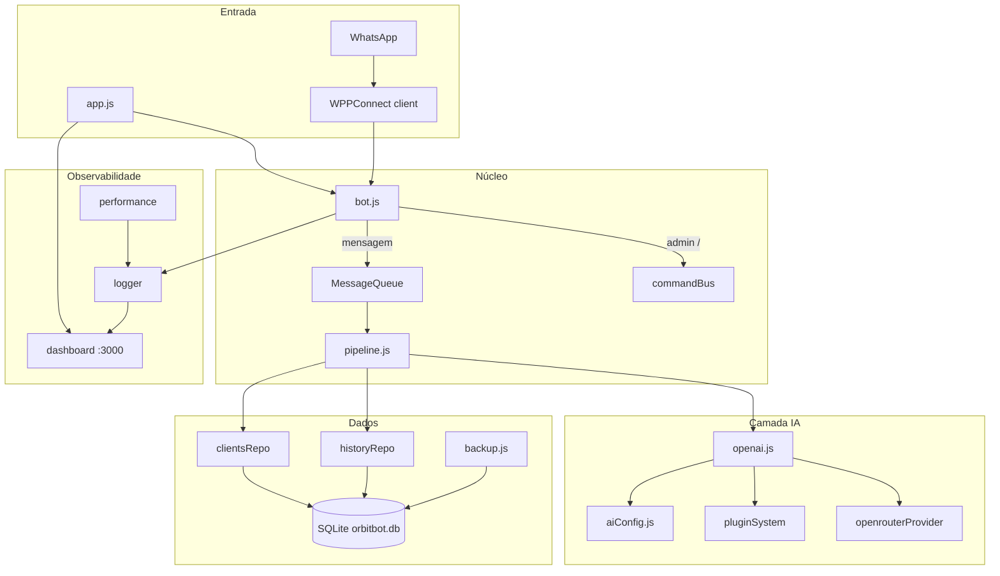
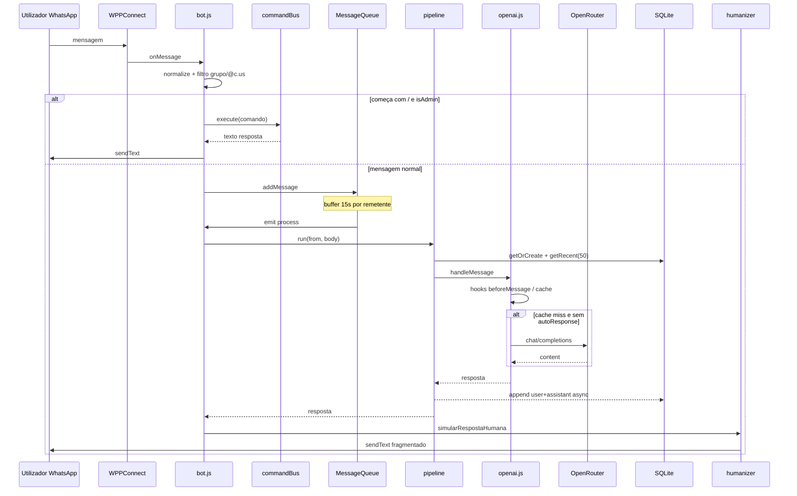
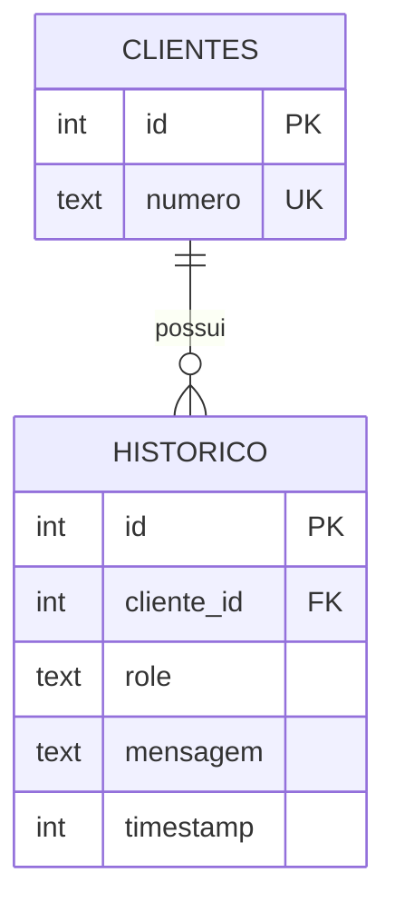

# OrbitBot — Relatório Geral Técnico

> Bot de WhatsApp com IA (OpenRouter/DeepSeek), SQLite, fila de mensagens, plugins e painel de métricas em tempo real.

[]()
[]()
[]()

**Data do relatório:** 2026-07-26  
**Fonte de verdade:** código-fonte do repositório (inspeção directa)  
**Escopo:** arquitetura, fluxo, dependências, banco, admin, modelos de IA, limitações conhecidas

---

## Sumário

- [1. Visão geral](#1-visão-geral)
- [2. Arquitetura](#2-arquitetura)
- [3. Fluxo de uma mensagem](#3-fluxo-de-uma-mensagem)
- [4. Dependências (libs)](#4-dependências-libs)
- [5. Banco de dados](#5-banco-de-dados)
- [6. Backup](#6-backup)
- [7. IA — modelos, prompts e provider](#7-ia--modelos-prompts-e-provider)
- [8. Comandos administrativos](#8-comandos-administrativos)
- [9. Plugins](#9-plugins)
- [10. Performance, cache, fila e retry](#10-performance-cache-fila-e-retry)
- [11. Dashboard e métricas](#11-dashboard-e-métricas)
- [12. Configuração e variáveis de ambiente](#12-configuração-e-variáveis-de-ambiente)
- [13. Estrutura de pastas](#13-estrutura-de-pastas)
- [14. Limitações e discrepâncias README ↔ código](#14-limitações-e-discrepâncias-readme--código)
- [15. Como executar](#15-como-executar)

---

## 1. Visão geral

O **OrbitBot** é um assistente pessoal via WhatsApp. Recebe mensagens através do **WPPConnect**, mantém contexto em **SQLite**, gera respostas via **OpenRouter** (modelo DeepSeek free) e devolve o texto com simulação de digitação humana.

| Dimensão | Decisão adoptada |
|----------|------------------|
| Canal | WhatsApp (sessão WPPConnect, pasta `./tokens`) |
| Persistência | SQLite (`database/data/orbitbot.db`) — sem JSON de conversas |
| IA | OpenRouter Chat Completions → DeepSeek V3 free |
| Admin | Comandos `/` no WhatsApp, whitelist por número |
| Observabilidade | Logger + PerformanceMonitor + dashboard HTTP/SSE na porta 3000 |
| Extensibilidade | `PluginSystem` com hooks + pasta `plugins/` |

**Responsabilidade do sistema:** responder conversas 1:1 de forma contextualizada, com histórico persistente, sem processar grupos.

---

## 2. Arquitetura

### 2.1 Topologia



**Porquê esta topologia:** separa canal (WPPConnect), orquestração (bot + fila + pipeline), IA (provider + config + plugins) e persistência (repos → SQLite). O dashboard só observa eventos do logger — não participa do caminho crítico da mensagem.

### 2.2 Bootstrap

```
npm start → node app.js
  ├─ startDashboardServer(3000)
  └─ startBot()
       ├─ performanceMonitor.start()
       ├─ regista comandos admin no commandBus
       ├─ wppconnect.create({ session: 'sessionName', ... })
       │    └─ sessão em ./tokens
       └─ client.onMessage + messageQueue.on('process')
```

Efeitos colaterais no `require`:
- `backup.js` — agenda backup automático a cada 6h
- `pluginSystem.js` — carrega plugins padrão + ficheiros em `plugins/`

### 2.3 Padrões reconhecíveis

| Padrão | Onde |
|--------|------|
| Repository | `clientsRepo`, `historyRepo` sobre `database/` |
| Command Bus | `commandBus` + handlers em `commands/admin/*` |
| Provider | `openrouterProvider` isolado do motor `openai.js` |
| Hook/Plugin | `pluginSystem` (`beforeMessage`, `afterMessage`, …) |
| Pipeline | `core/pipeline.js` orquestra dados → IA → persistência |

---

## 3. Fluxo de uma mensagem



**Passos detalhados:**

1. **Normalização** — `from`, `body`, `isGroupMsg`; chatId forçado a `numero@c.us`
2. **Filtro** — ignora grupos e IDs que não sejam `@c.us` / `@s.whatsapp.net`
3. **Admin shortcut** — `/…` de admin bypassa a fila
4. **Buffer** — mensagens do mesmo remetente agrupadas até 15s (combinadas com `\n`)
5. **Fila FIFO** — processamento sequencial
6. **Pipeline** — cliente + histórico em paralelo → IA → persistência fire-and-forget
7. **Humanizer** — fragmenta e atrasa envio (não usa indicador “digitando” nativo)

---

## 4. Dependências (libs)

Fonte: `package.json` / `package-lock.json`.

| Pacote | Versão declarada | Resolvida (lock) | Papel no OrbitBot |
|--------|------------------|------------------|-------------------|
| `@wppconnect-team/wppconnect` | `^1.41.0` | `1.41.0` | Sessão WhatsApp, QR, `onMessage`, `sendText` |
| `sqlite3` | `^5.1.7` | `5.1.7` | Persistência de clientes e histórico |
| `axios` | `^1.9.0` | `1.13.6` | HTTP para OpenRouter (+ plugin weather, não no fluxo principal) |
| `dotenv` | `^16.5.0` | `16.5.0` | Carrega `.env` em `src/openai.js` |

- **Sem `devDependencies`.**
- **Opcional não declarada:** `cacheable-lookup` (DNS cache em `openrouterProvider.js`, silenciosamente desactivada se ausente).
- **Runtime:** README indica Node ≥ 16; lock actual pode exigir Node ≥ 18 em transitivas — validar no ambiente (`TBD` de verificação local).

---

## 5. Banco de dados

### 5.1 Localização e lifecycle

| Item | Valor |
|------|--------|
| Ficheiro | `database/data/orbitbot.db` |
| Driver | `sqlite3` (instância única em `database/db/index.js`) |
| Schema | Aplicado com `CREATE TABLE IF NOT EXISTS` no boot |
| Migrations versionadas | Não existem |

### 5.2 Schema



```sql
CREATE TABLE IF NOT EXISTS clientes (
  id INTEGER PRIMARY KEY AUTOINCREMENT,
  numero TEXT UNIQUE NOT NULL
);

CREATE TABLE IF NOT EXISTS historico (
  id INTEGER PRIMARY KEY AUTOINCREMENT,
  cliente_id INTEGER NOT NULL,
  role TEXT NOT NULL,
  mensagem TEXT NOT NULL,
  timestamp INTEGER NOT NULL,
  FOREIGN KEY (cliente_id) REFERENCES clientes(id)
);

CREATE INDEX IF NOT EXISTS idx_historico_cliente ON historico(cliente_id);
CREATE INDEX IF NOT EXISTS idx_historico_timestamp ON historico(timestamp);
```

`role` tipicamente: `user` | `assistant`.

### 5.3 Camadas de acesso

```
database/db/index.js     → CRUD bruto (callbacks/Promises)
database/index.js        → fachada / alias PT (ex.: atualizarHistorico)
src/repositories/*       → API da aplicação
```

| API de repositório | Função |
|--------------------|--------|
| `clientsRepo.getOrCreate(number)` | Garante cliente |
| `historyRepo.append(clienteId, role, mensagem)` | Insere mensagem |
| `historyRepo.getPaged(identifier, page)` | Paginação (pageSize 50) |
| `historyRepo.getRecent(identifier, limit)` | Últimas N (pipeline usa 50) |

Identificadores aceites em histórico: `id` numérico ou `numero@c.us`.

### 5.4 Persistência no fluxo

No `pipeline`: após resposta da IA, `setImmediate` + `Promise.allSettled` grava pergunta e resposta **sem bloquear** o envio ao utilizador.

### 5.5 Cache vs DB

O cache em `src/core/cache.js` **não** cacheia linhas do SQLite — apenas respostas da IA (ver secção 10).

---

## 6. Backup

Implementação: `src/backup.js` (`BackupManager`).

| Aspecto | Comportamento |
|---------|---------------|
| Destino | `database/backups/<pasta>/` (cópia do `.db`) |
| Automático | A cada **6 horas**; nome `backup auto_DD-MM-AA_HH-MM` |
| Manual | `/backup criar [nome]` |
| Retenção | Mantém os **5** mais recentes; resto → `auto_delete` |
| Restore | Sobrescreve o `.db` activo (sem snapshot prévio do estado actual) |
| Log | `database/backups/backup_log.json` |

**Risco residual:** cópia com `copyFileSync` sem lock/`VACUUM INTO` — aceitável em baixa concorrência; pode corromper se houver escrita intensa no momento exacto.

---

## 7. IA — modelos, prompts e provider

### 7.1 Provider OpenRouter

| Campo | Valor |
|-------|--------|
| Endpoint | `POST https://openrouter.ai/api/v1/chat/completions` |
| Auth | `Authorization: Bearer $OPENROUTER_API_KEY` |
| Headers extra | `HTTP-Referer`, `X-Title: OrbitBot` |
| Payload | `model`, `messages`, `temperature`, `max_tokens` |
| Resposta usada | `choices[0].message.content` |
| Streaming / tools / multimodal | Não |

### 7.2 Modelos suportados (aliases)

Todos os aliases internos apontam para **o mesmo** model ID remoto:

| Alias interno | Model ID OpenRouter | maxTokens | temperature |
|---------------|---------------------|-----------|-------------|
| `deepseek-chat` | `deepseek/deepseek-chat-v3-0324:free` | 800 | 0.7 |
| `deepseek-coder` | `deepseek/deepseek-chat-v3-0324:free` | 800 | 0.5 |
| `deepseek-chat-33b` | `deepseek/deepseek-chat-v3-0324:free` | 800 | 0.7 |

**Conclusão:** três nomes configuráveis, **um** modelo remoto efectivo. Default: `deepseek-chat`.

Troca via WhatsApp (admin): `/ai modelo <alias>` — **em memória**, não persiste após restart.

### 7.3 Personalidades

| Key | Nome | systemPrompt (síntese) |
|-----|------|------------------------|
| `default` | Orbit - Assistente Pessoal | Claro, directo, educado; curto; pergunta se faltar contexto |
| `professional` | Orbit - Profissional | Tom profissional, objectivo, prático |
| `coder` | Orbit - Desenvolvedor | Precisão e concisão em código |
| `friendly` | Orbit - Amigável | Gentil, útil, acolhedor |

Troca: `/ai personalidade <nome>` (também redefine o alias de modelo da personalidade).

### 7.4 Tipos de contexto (`CONTEXT_TYPES`)

`conversation` (default, maxHistory 10), `technical` (15), `business` (8), `personal` (5).

**Nota:** não há comando admin para trocar `contextType`. O pipeline carrega até 50 mensagens do DB; o corte efectivo para a API depende da config/contexto/`OPENAI_MAX_HISTORY`.

### 7.5 Montagem do prompt (`openai.js`)

1. System = prompt da personalidade  
2. System opcional = resumo **local** (não-IA) do histórico excedente (até ~800 chars)  
3. Histórico recente  
4. Mensagem actual como `user`

### 7.6 `treinamento.js`

Contém prompt legado (ex.: pizzaria). **Não é importado por nenhum módulo** — código morto. O README que recomenda editá-lo está desactualizado; a fonte real é `aiConfig.js`.

### 7.7 Humanizer

`src/humanizer.js`: atraso inicial 400–600 ms; fragmenta por frases / blocos ≤180 chars; atrasos 150–350 ms entre partes. **Não** activa presença “digitando” no WhatsApp.

---

## 8. Comandos administrativos

### 8.1 Controlo de acesso

```javascript
// src/bot.js
const ADMIN_NUMBERS = ['…@c.us']; // whitelist hardcoded
```

- Formato: `CODIGOPAIS + NUMERO + @c.us`
- Não-admin que envia `/comando` → tratado como mensagem normal (vai para a IA), sem “acesso negado”
- Grupos: ignorados

### 8.2 Inventário completo

#### `/ai` — `src/commands/admin/ai.js`

| Sintaxe | Comportamento |
|---------|---------------|
| `/ai` | Menu de ajuda |
| `/ai personalidade listar` | Lista personalidades |
| `/ai personalidade info` | Personalidade actual |
| `/ai personalidade <nome>` | Define personalidade (+ modelo associado) |
| `/ai modelo listar` | Lista aliases |
| `/ai modelo info` | Modelo actual |
| `/ai modelo <alias>` | Define alias de modelo |
| `/ai plugin listar` | Plugins e estado 🟢/🔴 |
| `/ai plugin info <nome>` | Detalhe de um plugin |
| `/ai plugin <nome> on/off` | Activa/desactiva |
| `/ai stats` | Stats IA + plugins + cache |
| `/ai cache limpar` | Limpa cache de respostas |

> **Ausente do README** — documentado apenas aqui e no código.

#### `/backup` — `src/commands/admin/backup.js`

| Sintaxe | Comportamento |
|---------|---------------|
| `/backup` | Ajuda |
| `/backup criar [nome]` | Backup manual |
| `/backup listar` | Lista (Automático/Manual) |
| `/backup restaurar <nome>` | Match parcial case-insensitive |
| `/backup info <nome>` | Stats do backup |
| `/backup atual` | Stats do `.db` activo |
| `/backup excluir <nome>` | Remove pasta (sem confirmação dupla) |
| `/backup logs` | Últimas 10 operações |

#### `/historico` — `src/commands/admin/history.js`

| Sintaxe | Comportamento |
|---------|---------------|
| `/historico <id\|numero> [página]` | Página de 50 msgs; default página 1 |

#### `/reset` — `src/commands/admin/db.js`

| Sintaxe | Comportamento |
|---------|---------------|
| `/reset` | Aviso (não executa) |
| `/reset confirmar` | `DELETE` historico + clientes + reset `sqlite_sequence` |

Confirmação **dupla** apenas em `/reset`. Backups **não** são apagados.

---

## 9. Plugins

### 9.1 Motor (`pluginSystem.js`)

- Registo por nome/versão/descrição
- Hooks: usados no fluxo real — `beforeMessage`, `afterMessage`, `messageProcessed`
- Middleware: infraestrutura existe, **não** integrada no fluxo `bot`/`pipeline` (código morto na prática)
- Carrega `plugins/*.js` no boot

### 9.2 Plugins padrão (embutidos)

`sentimentAnalysis`, `commandDetector`, `autoResponse`, `statistics`

### 9.3 Plugins externos (`plugins/`)

| Plugin | Papel |
|--------|--------|
| `fastAutoReply.js` | Hook `beforeMessage`: saudações/curtas → `autoResponse` **sem** chamar OpenRouter |
| `weatherPlugin.js` | Exemplo (clima mock); middleware/commands não plenamente integrados ao bus |

Gestão: `/ai plugin …`

---

## 10. Performance, cache, fila e retry

| Componente | Ficheiro | Comportamento |
|------------|----------|---------------|
| Fila | `queue.js` | Buffer 15s/remetente + FIFO; retry de fila pouco efectivo para erros async |
| Cache IA | `core/cache.js` | TTL 30 min, max 1000, limpeza 5 min; eviction FIFO (não LRU real) |
| Chave cache | `openai.js` | `mensagem + lenHistórico + personalidade + modelo` (**não** inclui userId) |
| Retry API | `core/retry.js` | Backoff exponencial; 5xx/timeouts; **429 não** é retriado |
| Monitor | `performance.js` | Métricas a cada 60s |

---

## 11. Dashboard e métricas

- **URL:** `http://localhost:3000/`
- **SSE:** `/events`
- **Auth:** nenhuma
- **Dados:** logs + métricas em memória (uptime, msgs, erros, heap, CPU load, contagens SQLite)

Reinício do processo zera o painel (excepto o que já está no DB).

---

## 12. Configuração e variáveis de ambiente

Carregadas via `dotenv` em `src/openai.js`. Não há `.env.example` no repo (`.env*` no `.gitignore`).

<details>
<summary><strong>Variáveis de ambiente</strong></summary>

| Variável | Obrigatória | Default | Descrição |
|----------|-------------|---------|-----------|
| `OPENROUTER_API_KEY` | sim | — | Bearer para OpenRouter |
| `OPENAI_MAX_RETRIES` | não | `3` | Tentativas totais da operação com retry |
| `OPENAI_INITIAL_TIMEOUT` | não | `8000` | Timeout inicial (ms) |
| `OPENAI_MAX_TIMEOUT` | não | `30000` | Timeout máximo (ms) |
| `OPENROUTER_TEMPERATURE` | não | — | Override da temperatura do modelo |
| `OPENROUTER_MAX_TOKENS` | não | — | Override de max tokens |
| `OPENAI_MAX_HISTORY` | não | — | Override do limite de histórico enviado à API |

</details>

**Admin:** editar `ADMIN_NUMBERS` em `src/bot.js`.  
**Sessão WhatsApp:** pasta `./tokens` (não versionada).

---

## 13. Estrutura de pastas

```
OrbitBot/
├── app.js                          # entrypoint
├── package.json
├── README.md
├── docs/
│   └── RELATORIO-GERAL.md          # este relatório
├── plugins/
│   ├── fastAutoReply.js
│   └── weatherPlugin.js
├── database/
│   ├── index.js                    # fachada
│   ├── db/index.js                 # schema + CRUD
│   ├── data/orbitbot.db
│   └── backups/
└── src/
    ├── bot.js                      # núcleo WhatsApp
    ├── dashboard.js
    ├── queue.js
    ├── openai.js
    ├── aiConfig.js
    ├── humanizer.js
    ├── backup.js
    ├── pluginSystem.js
    ├── logger.js
    ├── performance.js
    ├── treinamento.js              # legado / não usado
    ├── providers/openrouterProvider.js
    ├── core/{pipeline,cache,retry}.js
    ├── repositories/{clients,history}Repo.js
    └── commands/
        ├── commandBus.js
        └── admin/{ai,backup,db,history}.js
```

---

## 14. Limitações e discrepâncias README ↔ código

| # | Achado | Impacto |
|---|--------|---------|
| 1 | `/ai` não documentado no README | Onboarding incompleto |
| 2 | README pede API key em `openai.js`; código usa `OPENROUTER_API_KEY` + dotenv | Config incorrecta se seguir README |
| 3 | `treinamento.js` morto; README ainda aponta para ele | Personalidade real em `aiConfig.js` |
| 4 | “Contexto total” no README vs `getRecent(50)` + maxHistory de contexto | Expectativa inflada |
| 5 | 3 aliases de modelo → 1 model ID free | Troca de “modelo” só muda temp/alias |
| 6 | Preferências IA não persistem (restart = default) | Config volátil |
| 7 | Cache sem `userId` na chave | Risco teórico de colisão entre utilizadores |
| 8 | Middleware de plugins não ligado ao fluxo | weatherPlugin middleware inerte |
| 9 | Retry da fila pouco efectivo com listeners `async` | Estabilidade documentada > real |
| 10 | Restore/excluir backup sem confirmação dupla | Risco operacional |
| 11 | Admin hardcoded (sem tabela/env) | Deploy menos flexível |
| 12 | Sem auth no dashboard :3000 | Expor só em localhost |

---

## 15. Como executar

```bash
git clone https://github.com/GaabDevWeb/OrbitBot.git
cd OrbitBot
npm install

# criar .env na raiz
echo 'OPENROUTER_API_KEY=sua-chave' > .env

npm start
# Dashboard: http://localhost:3000
# Terminal: escanear QR Code do WhatsApp
```

Comandos admin apenas de números em `ADMIN_NUMBERS` (`src/bot.js`).

---

## Manutenibilidade

| Item | Estado |
|------|--------|
| Consolicação `.agent_history.md` | Ciclo MegaBrain 2026-07-26 — relatório documental (sem feature nova) |
| Evidência | Exploração de `app.js`, `src/**`, `database/**`, `plugins/**`, `package.json` |
| Phase 0.5 PRD | Excepção documentada — pedido = relatório, não RF novo |
| Testes automatizados | Ausentes no repo (`TBD` se forem introduzidos) |
| `.env.example` | Ausente (`TBD` recomendado) |

---

## Referências internas

- README: [`../README.md`](../README.md)
- Migração Venom → WPPConnect: [`../AGENTE_MIGRACAO_VENOM_PARA_WPPCONNECT.md`](../AGENTE_MIGRACAO_VENOM_PARA_WPPCONNECT.md)
- Config IA: [`../src/aiConfig.js`](../src/aiConfig.js)
- Schema DB: [`../database/db/index.js`](../database/db/index.js)
- Comandos: [`../src/commands/admin/`](../src/commands/admin/)
