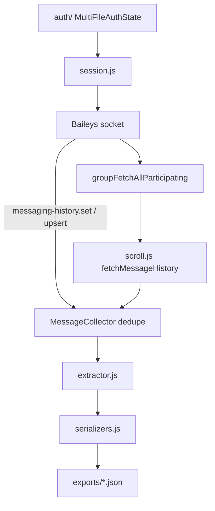

# Relatório — Exportador de histórico WhatsApp (Baileys)

**Data:** 2026-07-30  
**Branch:** `feature/orbit-kernel-tracing`  
**Abordagem:** A — Baileys nativo (aprovada)  
**Local:** `tools/whatsapp-history/`

## 1. Objectivo

Exportar semanas/meses de conversa de um grupo WhatsApp para JSON estruturado, reutilizando `auth/` do Orbit, sem login/QR, sem Kernel, sem envio de mensagens.

## 2. Arquitectura da solução



## 3. Estratégia de scroll

Iterativo on-demand:

1. Seed via sync/upsert (+ `presenceSubscribe`).
2. `fetchMessageHistory(batch, oldestKey, oldestTs)`.
3. Contar mensagens **novas** após espera.
4. Progresso → reset stale; sem progresso → `stale++`.
5. Parar em: `stale >= N`, `--messages`, `--days` / `--until`, ou histórico esgotado.

**Não** usa número fixo de scrolls cego.

## 4. Estratégia de deduplicação

Map `id → mensagem` com chave `jid|participant|msgId|fromMe`. Ingestão incremental — sem reprocessar o DOM/array global.

## 5. Schema JSON final

Ver `tools/whatsapp-history/README.md` (campo `messages[]` com `id`, `timestamp`, `author`, `text`, `type`, `isGroup`, `hasMention`, `mentions`, `quoted`).

## 6. Instruções de uso

```bash
# 1) Parar Orbit
# 2) Exportar
npm run export:history -- --group "ADS 2026" --days 30
```

## 7. Limitações

Documentadas no README da ferramenta (limites do linked device, seed, mídia, conflito de sessão).

## 8. Ficheiros entregues

| Path | Função |
|------|--------|
| `tools/whatsapp-history/exporter.js` | CLI |
| `tools/whatsapp-history/session.js` | Auth reuse |
| `tools/whatsapp-history/scroll.js` | Fetch + progresso |
| `tools/whatsapp-history/extractor.js` | Schema |
| `tools/whatsapp-history/serializers.js` | Save + métricas |
| `tools/whatsapp-history/README.md` | Uso |
| `docs/WHATSAPP-HISTORY-EXPORTER.md` | Este relatório |
| `exports/` | Saída (gitignored) |

## 9. Validação nesta sessão

| Check | Resultado |
|-------|-----------|
| `node --check` nos módulos | a executar |
| `--help` CLI | a executar |
| Export E2E contra grupo real | **manual** (requer auth viva + Orbit parado) |

## 10. Próximos passos recomendados

1. Correr export E2E num grupo de teste com Orbit parado.
2. Opcional: export 1:1 (`--jid`).
3. Opcional: download de mídia para pasta paralela.
4. Pipeline Kernel: importar JSON para análise offline (fora deste escopo).
