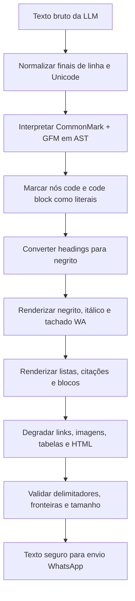

# OrbitBot — Especificação de mapeamento Markdown → WhatsApp

> Contrato técnico para transformar texto produzido por LLM em sintaxe nativa do WhatsApp, preservando código e degradando recursos Markdown sem equivalente.

[]()
[]()
[]()

**Escopo:** especificação de um futuro parser/sanitizador; não implementa nem prescreve uma biblioteca JavaScript.  
**Fonte primária:** [WhatsApp Help Center — How to format your messages](https://faq.whatsapp.com/539178204879377/), consultada em 2026-07-28.  
**Status de plataforma:** listas, citações e código inline são descritos pela fonte oficial como “new text formatting” disponível apenas no WhatsApp Web e Mac desktop. Tratar a apresentação nesses recursos em Android, iOS e Windows como risco de compatibilidade até validação manual.

## Sumário

- [Hero](#hero)
- [Matriz de mapeamento](#matriz-de-mapeamento)
- [Pipeline de transformação](#pipeline-de-transformação)
- [Aninhamento e limites](#aninhamento-e-limites)
- [Regras normativas do sanitizador](#regras-normativas-do-sanitizador)
- [Casos de teste sintéticos](#casos-de-teste-sintéticos)
- [Não suportado e degradação](#não-suportado-e-degradação)
- [Regex, fronteiras e validação](#regex-fronteiras-e-validação)
- [Riscos, TBDs e manutenção](#riscos-tbds-e-manutenção)
- [Fontes](#fontes)

## Hero

O OrbitBot recebe texto que pode conter Markdown CommonMark e extensões GFM, mas o WhatsApp interpreta outra gramática textual. A incompatibilidade mais perigosa é `*`: em Markdown costuma indicar itálico, enquanto no WhatsApp indica negrito. Portanto, a transformação **não é** uma simples remoção de caracteres; ela converte uma representação semântica em delimitadores WhatsApp, protegendo antes os trechos literais.

O destino suporta oficialmente itálico, negrito, tachado, monoespaçado, listas, listas numeradas, citação e código inline. Não há uma opção para desativar a formatação no cliente WhatsApp; assim, texto literal que se pareça com marcação deve ser preservado em código inline ou bloco monoespaçado quando necessário.

## Matriz de mapeamento

| Elemento | MD (CommonMark/GFM) | WA | Entrada LLM | Saída WA | Notas |
|---|---|---|---|---|---|
| Negrito | `**texto**` ou `__texto__` | `*texto*` | `**Atenção**` | `*Atenção*` | Converter ambos os delimitadores MD para um asterisco WA. |
| Itálico com asterisco | `*texto*` | `_texto_` | `*ênfase*` | `_ênfase_` | Conversão obrigatória: `*` em WA significa negrito. |
| Itálico com underscore | `_texto_` | `_texto_` | `_ênfase_` | `_ênfase_` | Só preservar quando o token for itálico válido, nunca parte de identificador. |
| Negrito + itálico | `***texto***`, `**_texto_**` ou `__*texto*__` | `*_texto_*` | `***crítico***` | `*_crítico_*` | O formato final deve ser corretamente aninhado. |
| Tachado | `~~texto~~` (GFM) | `~texto~` | `~~cancelado~~` | `~cancelado~` | Requer GFM na entrada. |
| Código inline | `` `texto` `` | `` `texto` `` | ``Use `npm test`.`` | ``Use `npm test`.`` | Conteúdo é literal; não converter formatação interna. |
| Bloco de código | fence ```` ```[linguagem] ```` | ```` ```texto``` ```` | ```` ```js\nconst x = 1;\n``` ```` | ```` ```\nconst x = 1;\n``` ```` | Remover a linguagem; o FAQ não documenta tag de linguagem. |
| Título ATX | `# Título` a `###### Título` | `*Título*` | `## Instalação` | `*Instalação*` | Estratégia recomendada; títulos não são nativos no WA. |
| Título Setext | `Título\n---` ou `Título\n===` | `*Título*` | `Resumo\n---` | `*Resumo*` | Consumir a linha de sublinhado. |
| Lista não ordenada | `* item`, `- item`, `+ item` | `* item` ou `- item` | `- um` | `- um` | Preferir hífen para eliminar ambiguidade visual com negrito. |
| Lista ordenada | `1. item` | `1. item` | `1. abrir` | `1. abrir` | Preservar numeração e espaço. |
| Citação | `> texto` | `> texto` | `> fonte` | `> fonte` | Disponibilidade deve ser validada por plataforma. |
| Link | `[rótulo](https://exemplo.test)` | URL simples | `[Docs](https://exemplo.test/a)` | `Docs: https://exemplo.test/a` | WA não documenta link Markdown; URL pode ser auto-linkada pelo cliente. |
| Autolink | `<https://exemplo.test>` | URL simples | `<https://exemplo.test>` | `https://exemplo.test` | Remover somente os delimitadores de autolink. |
| Imagem | `` | sem mídia nativa no texto | `` | `Logo: https://x.test/a.png` | Não tentar enviar mídia; isso pertence a outro contrato de transporte. |
| Tabela GFM | pipes e linha delimitadora | sem tabela nativa | tabela de duas colunas | lista rotulada | Converter cada linha de dados para `- Coluna: valor`; ver degradação. |
| Regra horizontal | `---`, `***`, `___` | sem equivalente | `---` | `────────` | Separador visual ASCII/Unicode, somente fora de código. |
| Escape Markdown | `\*literal\*` | texto literal | `\*não negrito\*` | `*não negrito*` | Remover escape após reconhecer o token; preservar o conteúdo literal. |
| HTML inline/bloco | `<u>texto</u>` | sem HTML | `<u>texto</u>` | `texto` | Sanitizar tags; underline não é recurso nativo. |

## Pipeline de transformação



O parser semântico vem antes de qualquer substituição de delimitador porque o mesmo caractere pode representar itálico, negrito, uma lista ou conteúdo literal. Nós de código formam uma fronteira rígida: nenhuma regra Markdown posterior pode operar dentro deles. A etapa final valida o texto WhatsApp gerado, em vez de tentar inferir novamente o Markdown original.

### Ordem normativa de conversão

1. Normalizar `CRLF` para `LF`, sem remover quebras de linha significativas.
2. Interpretar CommonMark + GFM em uma AST. Uma implementação baseada exclusivamente em regex **não DEVE** ser considerada conforme.
3. Proteger nós `code` e `code_block`, incluindo delimitadores internos e escapes.
4. Converter headings antes de renderizar ênfase.
5. Renderizar `strong` (`*...*`), `strikethrough` (`~...~`) e `emphasis` (`_..._`) por nós, não por busca global.
6. Renderizar listas e citações linha a linha; preservar recuo somente quando ele for comprovadamente legível no cliente-alvo.
7. Degradar links, imagens, tabelas, HTML e regras horizontais.
8. Remover apenas escapes Markdown já interpretados e validar balanceamento de delimitadores WA.

## Aninhamento e limites

### Combinações aceitas

As combinações abaixo são **evidência secundária/empírica**, não uma garantia explícita do FAQ oficial:

| Semântica | Sintaxe WA canônica | Regra de fechamento |
|---|---|---|
| Negrito + itálico | `*_texto_*` | fecha `_` antes de `*` |
| Negrito + tachado | `~*texto*~` | fecha `*` antes de `~` |
| Itálico + tachado | `~_texto_~` | fecha `_` antes de `~` |
| Tripla combinação | `~*_texto_*~` | fecha em ordem inversa à abertura |

O renderizador **DEVE** abrir marcadores conforme a pilha de nós da AST e fechá-los em LIFO. Para um nó com três estilos, a forma canônica é `~*_texto_*~`; outras ordens podem renderizar, mas não devem ser geradas sem teste de interoperabilidade.

### Limites rígidos

- `code` e `code_block` **NÃO DEVEM** combinar monoespaçado com negrito, itálico ou tachado. Marcadores internos são texto literal.
- Um delimitador WA não pode ter espaço imediatamente após a abertura ou antes do fechamento: `* texto *` e `_ texto _` não são saída válida.
- O sanitizador **DEVE** limitar o aninhamento gerado a três estilos (`strong`, `emphasis`, `strikethrough`); níveis superiores devem degradar para texto sem o estilo excedente.
- Listas aninhadas não possuem contrato oficial de recuo visual. O padrão seguro é achatar para linhas no mesmo nível, prefixando subitens com `- `, até que exista matriz de teste por cliente.

## Regras normativas do sanitizador

### DEVE

1. **DEVE** tratar Markdown como estrutura (AST/tokens), não como sequência plana de caracteres.
2. **DEVE** preservar byte a byte o conteúdo de `code` e `code_block`, exceto pela remoção da tag de linguagem da fence.
3. **DEVE** traduzir `strong` de Markdown para `*...*` e `emphasis` para `_..._`.
4. **DEVE** reconhecer `~~...~~` apenas como tachado GFM e gerar `~...~`.
5. **DEVE** converter headings para uma linha em negrito sem `#`.
6. **DEVE** transformar links em texto legível mais URL explícita, sem supor suporte a `[rótulo](URL)`.
7. **DEVE** garantir que `produto_id_novo`, `v1_2` e similares permaneçam literais; underscores dentro de palavra não são itálico.
8. **DEVE** emitir listas como `- item` por padrão e preservar `1. item` nas numeradas.
9. **DEVE** manter uma suíte de casos de compatibilidade por cliente WhatsApp e registrar versão/data da validação.
10. **DEVE** operar em modo fail-safe: token Markdown ambíguo ou malformado permanece texto literal, em vez de criar formatação não solicitada.

### NÃO DEVE

1. **NÃO DEVE** substituir globalmente `*` por `_` ou `**` por `*`: isso corrompe listas, escapes e código.
2. **NÃO DEVE** deixar a tag de linguagem (`js`, `json`, `bash`) após abrir um bloco monoespaçado.
3. **NÃO DEVE** produzir underline, cabeçalhos, tabelas, HTML, cores ou fontes como se fossem recursos nativos.
4. **NÃO DEVE** enviar delimitadores WA vazios (`**`, `__`, `~~`, `****`) criados pela conversão.
5. **NÃO DEVE** converter delimitadores presentes dentro de URLs, identificadores, hashes, comandos ou conteúdo de código.
6. **NÃO DEVE** assumir que listas, citação ou código inline renderizam da mesma forma em Android, iOS, Windows, Web e Mac.
7. **NÃO DEVE** usar regex para reconhecer Markdown aninhado arbitrário; regex pode apenas complementar validações locais pós-renderização.

## Casos de teste sintéticos

Cada caso é um contrato de transformação. O campo “resultado visual” se refere à interpretação esperada do WhatsApp, enquanto a coluna de saída mostra a string que o bot envia.

| # | Entrada LLM (Markdown) | Saída WA esperada | Cobertura |
|---:|---|---|---|
| 1 | `**urgente**` | `*urgente*` | negrito |
| 2 | `*ênfase*` | `_ênfase_` | conflito asterisco MD/WA |
| 3 | `_ênfase_` | `_ênfase_` | itálico com underscore |
| 4 | `***crítico***` | `*_crítico_*` | negrito + itálico |
| 5 | `~~cancelado~~` | `~cancelado~` | tachado GFM |
| 6 | ``**Execute `npm test`**`` | ``*Execute `npm test`*`` | código protegido dentro de negrito |
| 7 | `# Plano` | `*Plano*` | heading ATX |
| 8 | `- alfa\n  - beta` | `- alfa\n- beta` | lista aninhada achatada |
| 9 | `> observação` | `> observação` | citação |
| 10 | `[Documentação](https://exemplo.test/docs)` | `Documentação: https://exemplo.test/docs` | link |
| 11 | `produto_id_novo` | `produto_id_novo` | underscore dentro de palavra |
| 12 | `* texto *` | `* texto *` | delimitadores inválidos preservados |
| 13 | `***muito crítico***` | `*_muito crítico_*` | combinação tripla parcial |
| 14 | ```` ```js\nconst valor = "**literal**";\n``` ```` | ```` ```\nconst valor = "**literal**";\n``` ```` | fence com linguagem + proteção |
| 15 | `| Chave | Valor |\n| --- | --- |\n| A | 1 |` | `- Chave: A\n- Valor: 1` | tabela GFM degradada (1 linha → pares por coluna) |
| 16 | `` | `Diagrama: https://exemplo.test/a.png` | imagem sem transporte |

### Casos expressos em blocos

**Caso 6 — código não deve ser reinterpretado**

Entrada:
````text
**Execute `npm test` antes do deploy.**
````

Saída:
````text
*Execute `npm test` antes do deploy.*
````

**Caso 14 — tag de linguagem não é conteúdo WhatsApp**

Entrada:
````text
```js
const valor = "**literal**";
```
````

Saída:
````text
```
const valor = "**literal**";
```
````

## Não suportado e degradação

| Recurso de origem | Motivo | Degradação obrigatória |
|---|---|---|
| Imagem Markdown | A sintaxe textual não cria mídia no WA | `alt: URL`; módulo de mídia é escopo separado. |
| Tabela GFM | Sem tabela nativa | Lista de pares `- Cabeçalho: valor`; não usar blocos “desenhados” como contrato. |
| Underline | Não há sintaxe WA documentada | Remover estilo; preservar o texto. |
| HTML | Não há HTML nativo | Remover tags e manter conteúdo textual. |
| Links com rótulo | Não há Markdown link documentado | `rótulo: URL`. |
| Task list | Não há checkbox nativo documentado | `- [ ]` e `- [x]` como texto literal legível. |
| Regra horizontal | Sem equivalente | `────────`, em linha própria. |
| Footnotes, referências e citações bibliográficas | Sem mecanismo nativo | Texto da nota seguido de URL, quando houver. |
| Bloco de citação multiline aninhado | Sem contrato oficial de aninhamento | Um prefixo `> ` por linha; achatar níveis adicionais. |

## Regex, fronteiras e validação

Regex é apropriada para verificações pós-renderização pontuais; não substitui o parser CommonMark/GFM. Exemplos de guardas locais:

| Finalidade | Padrão ilustrativo | Uso permitido | Limite |
|---|---|---|---|
| Detectar bullet WA | `^(?:\*|-)\s+\S` (multiline) | validar linhas já renderizadas | não determina se `*` era itálico MD |
| Detectar lista numerada | `^\d+\.\s+\S` (multiline) | validar estrutura final | não interpreta listas iniciadas em outros números |
| Identificador com underscore | `(?<=\w)_(?=\w)` | impedir criação de itálico no meio da palavra | requer engine com lookbehind; alternativa é tokenização |
| Espaço junto ao delimitador | `(?:\*\s|\s\*|_\s|\s_|~\s|\s~)` | sinalizar saída WA não formatável | não deve alterar código protegido |
| Fence de linguagem | ````^```[^\s`]*\s*$```` (multiline) | remover tag somente no nó `code_block` | nunca aplicar no texto bruto |

### Invariantes pós-renderização

- Cada segmento estilizado gerado pelo renderer tem delimitador de abertura e fechamento compatíveis.
- Não há marcador de estilo vazio.
- Nenhuma transformação ocorre entre backticks simples ou fences triplas já identificadas.
- Linhas de lista começam com `- ` ou `* `; uma sequência `*palavra*` nunca é reclassificada como lista.
- URL final não recebe delimitadores de estilo ao redor, salvo se a AST a tiver como parte explícita de um nó de ênfase.

## Riscos, TBDs e manutenção

| Item | Estado | Critério de encerramento |
|---|---|---|
| Listas, citações e código inline fora de Web/Mac | TBD de compatibilidade | Enviar a suíte sintética em Android, iOS, Windows, Web e Mac; registrar captura e versão. |
| Profundidade máxima de aninhamento WA | Empírico | Testar 1–4 níveis com combinações de `*`, `_` e `~`; manter o limite seguro de três até então. |
| Recuo visual de listas aninhadas | Não documentado no FAQ | Aprovar matriz manual por plataforma ou manter achatamento. |
| Links automáticos | Comportamento de cliente, não Markdown WA | Testar URLs com parênteses, pontuação terminal e domínio internacionalizado. |
| Limites de comprimento e fragmentação | Fora deste contrato | Definir no contrato de envio Baileys, sem quebrar fences, delimitadores ou URLs. |

Esta especificação consolida a decisão documental de 2026-07-28: o futuro componente deve ser um parser/sanitizador isolado entre a resposta da LLM e o transporte Baileys. O histórico do repositório confirma Baileys como engine WhatsApp atual; não há implementação de parser Markdown no escopo desta entrega.

## Fontes

1. **Primária — WhatsApp Help Center.** [How to format your messages](https://faq.whatsapp.com/539178204879377/). Define oficialmente `_texto_`, `*texto*`, `~texto~`, três backticks para monoespaçado, listas, lista numerada, citação e código inline; também informa a limitação de disponibilidade do novo formato.
2. **Secundária — SendPulse.** [WhatsApp Text Formatting: The Complete Guide](https://sendpulse.com/blog/whatsapp-text-formatting). Usada apenas como evidência auxiliar para ausência de espaços, combinação de estilos e monoespaçado literal.
3. **Secundária — MD2WA.** [The Complete Guide to WhatsApp Text Formatting](https://markdowntowhatsapp.com/en/blog/complete-guide-whatsapp-text-formatting). Usada apenas como evidência auxiliar de limitações de headings, links Markdown, tabelas e formatação dentro de código.
4. **Referência de origem.** [CommonMark Spec](https://spec.commonmark.org/) e [GitHub Flavored Markdown Spec](https://github.github.com/gfm/). Definem a linguagem de entrada; o comportamento WhatsApp não deve ser inferido a partir delas.

As fontes secundárias não substituem a documentação oficial nem testes reais nos clientes WhatsApp. Onde o FAQ não confirma comportamento — principalmente aninhamento, fronteiras de palavra e diferenças de plataforma — este documento marca a regra como empírica ou `TBD`.
